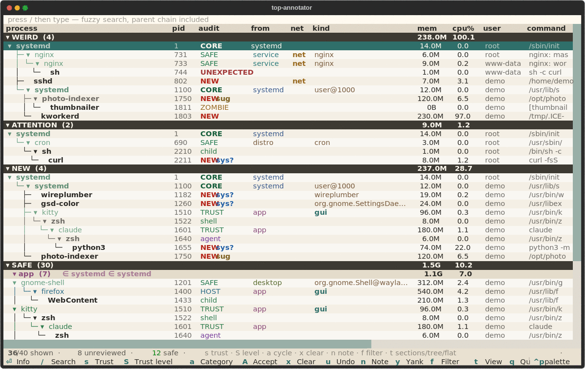

# Top Annotator — what have I not audited yet?

[](LICENSE)
[](https://www.python.org/)
[](https://astral.sh/uv)
[](https://just.systems/man/en/)
[](.agents/kanon.md)

> [!WARNING]
> **Do not trust this project blindly.** It is one person's tool and one
> person's audit. Ask your agent (Claude, Cline, …) to review it, then copy it
> into a repository of your own and let your agent maintain it. Why:
> [docs/philosophy.md](docs/philosophy.md).

A tiny, deliberately dumb terminal process viewer for one question:

> Which process on this machine have I **not** audited yet?

`btop` shows everything. This shows the same tree with an audit column, so the
unknown stands out and what you already trust fades into the background.



The recording is `top-annotator --demo`: a bundled fictional machine, so you
can try it without exposing yours. See [docs/demo.md](docs/demo.md).

- **Read-only.** It reads `/proc`; it never kills, signals or writes to a
  process.
- **Offline.** No network, no telemetry, no update check.
- **Agent-ready.** JSON commands let an agent explain a process and propose a
  trust level; the human decides.
  - In Claude Code, `/audit analyse` gives a post-it report of what looks
    odd; `/audit update` proposes levels for what is not annotated yet.

I built it for myself, auditing my own workstation, then made it public.

## Install

Linux, [uv](https://docs.astral.sh/uv/getting-started/installation/), and:

```bash
git clone https://github.com/Ophiase/top-annotator
cd top-annotator
uv run top-annotator
```

Every other way, what each needs, and what is not ready yet:
[docs/install.md](docs/install.md).

## Start here

| If you want | Go to |
| --- | --- |
| Why not to trust this repository, and what to do instead | [docs/philosophy.md](docs/philosophy.md) |
| Every way to install | [docs/install.md](docs/install.md) |
| Try it on a fictional machine, record the GIF | [docs/demo.md](docs/demo.md) |
| The screen, the bands and the keys | [docs/screen.md](docs/screen.md) |
| What a signature is, how sure a `safe` is | [docs/signatures.md](docs/signatures.md) |
| Trust levels, providers, parents and children | [docs/trust.md](docs/trust.md) |
| Where annotations live, history and undo | [docs/audit-folder.md](docs/audit-folder.md) |
| Ask an agent to explain a process | [docs/agents.md](docs/agents.md) |
| Protect the audit against tampering | [docs/hardening.md](docs/hardening.md) |
| The open ideas | [ideas/](ideas/README.md) |

## In thirty seconds

1. The default view has three bands: `WEIRD`, `NEW` (bold red), then `SAFE`.
2. `s` marks the selected process `trust`; `S` picks a precise level.
3. `NEW sug` means the base suggests a level for an optional program: `Enter`
   shows it, `A` accepts it.
4. Your marks go to `~/.local/share/top-annotator/session.yaml`, over a
   bundled base audit; `u` undoes the last one.
5. `/` searches and keeps each match's whole parent chain.

## Develop

```bash
uv sync --all-groups
just checks                     # markdown + lint + format + types + tests
just gate                       # checks, then the portable and project guards
just audit                      # lock, known vulnerabilities, licences (network)
```

Code layout and agent rules are in [AGENTS.md](AGENTS.md); how to contribute
an audit for your distribution is in [CONTRIBUTING.md](CONTRIBUTING.md).

`<>`
