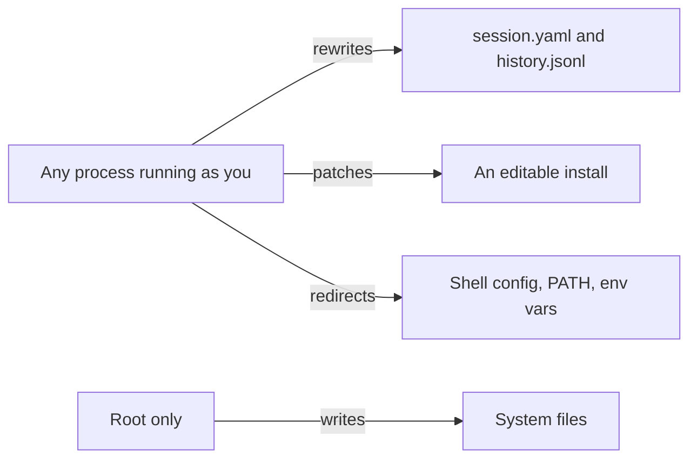

# Hardening

**In one line:** by default, anything that runs as you can rewrite your audit
and the tool itself. Hardening means taking that write access away from your
user, then making any change you did not sign visible.

An audit is a trust list. Whoever writes it decides what fades into the
background, so the audit files are the first thing malware would target.

## Who can write what, by default

- `just install` is an **editable** install from your checkout: the code it
  runs is as writable as the checkout.
- `$TOP_ANNOTATOR_AUDIT`, `$TOP_ANNOTATOR_DATA_DIR` and `PATH` come from your
  shell config, which your user can rewrite.
- `history.jsonl` is append-only by convention, not by permission.

## Threats

| Threat | How | What protects you today |
| --- | --- | --- |
| Self-trusting malware | marks its own signature `trust` in `session.yaml`, erases the journal line | nothing local; options 1 and 3 below |
| Patched tool | edits the editable install so a process never shows | option 2 |
| Redirected tool | an alias or env var points to a fake audit or a fake binary | option 2 and the status line |
| Poisoned base | a contribution marks a malicious signature `safe` | review: a signature includes the executable path, so it only covers a binary in a root-owned place |
| Injected agent | a process name or command line carries text aimed at the agent | the human confirms every write |
| Root compromise | everything above, plus `/proc` itself | out of scope: no local tool survives it |

## Options today, cheapest first

1. **Keep your layer in git.** Commit `~/.local/share/top-annotator/` after
   each session and sign the commits (`git config gpg.format ssh`). A change
   you did not make shows in `git diff`. This detects; it does not prevent.
2. **Install a root-owned copy.** Install a non-editable build into a
   root-owned directory and launch it by its absolute path. Your processes can
   no longer patch the code you run.
3. **Make the audit root-owned.** Point `$TOP_ANNOTATOR_AUDIT` at a root-owned
   folder. The base can no longer be rewritten by your user; changing it takes
   `sudo`.
4. **Check identity, not only trust.** `Enter` on a process, or
   `top-annotator verify PATH`, shows the package owner and `dpkg -V`.
5. **Read the status line.** It names the folders actually read: a redirected
   audit shows there.

## Incoming

Not implemented yet; open for discussion in
[ideas/signed-journal.md](../ideas/signed-journal.md) and
[ideas/root-install.md](../ideas/root-install.md).

| Mechanism | What it adds |
| --- | --- |
| Signed journal | every line hash-chains the previous one and is signed with your SSH or FIDO key; a broken chain or a bad signature goes `WEIRD` |
| Agent proposals | `annotate` from an agent writes an unsigned proposal; it counts only once you sign it |
| Root-owned layer | a small privileged helper is the only writer of your layer |
| Signed base | the bundled base is checked against the release signature at load time |

A key loaded in `ssh-agent` can be used by any process running as you. Only a
key that asks for a touch (`ed25519-sk`, `-O verify-required`) or a passphrase
each time is a real boundary.
